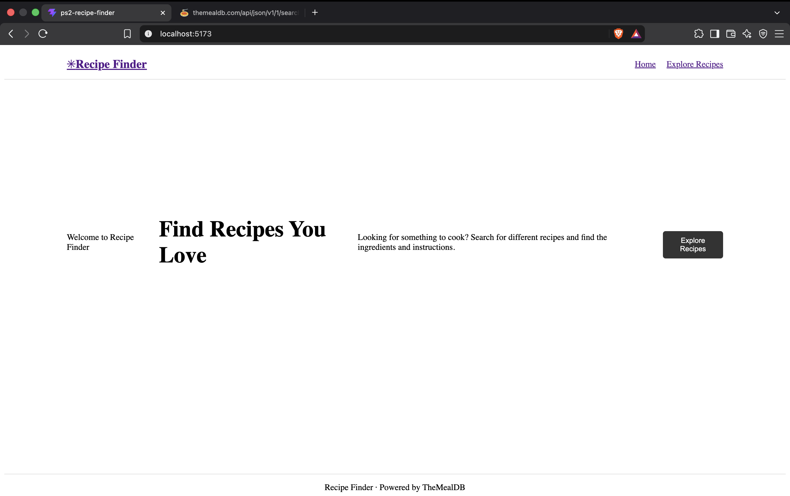
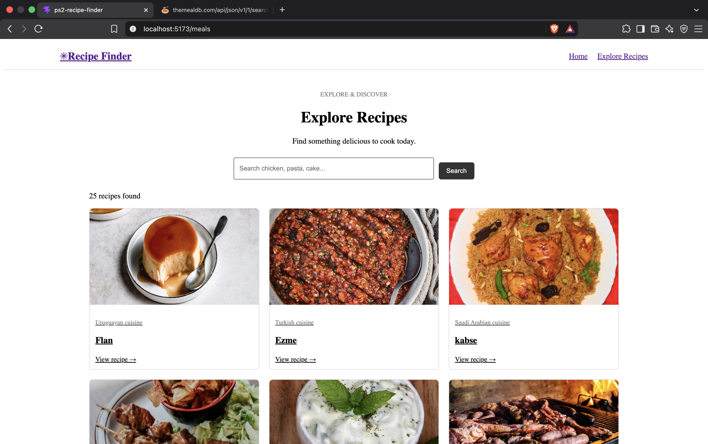

# PS2 - Recipe Finder

## About
This is a recipe finder website built using React.
Users can search for meals and view their ingredients,
cooking instructions and available YouTube videos.

## Features
- Search recipes by name
- View recipe images and details
- See ingredients and measurements
- Read cooking instructions
- Open recipe videos on YouTube
- Navigate between pages using React Router
- Show a page not found message for invalid routes

## Technologies Used
- React
- Vite
- React Router
- CSS
- TheMealDB API

## API Used
TheMealDB API: https://www.themealdb.com/api.php

- Search recipes: `search.php?s=chicken`
- Recipe details: `lookup.php?i=52772`

## Routes
| Route | Description |
|---|---|
| `/` | Home page |
| `/meals` | Search and view recipes |
| `/meal/:id` | View recipe details |
| `*` | Page not found |

## Screenshots

### Home Page

### Recipe Details

## Run Locally
1. Clone your GitHub repository.
2. Open the project folder in the terminal.
3. Run `npm install`.
4. Run `npm run dev`.
5. Open the local URL shown in the terminal.

## Author
Yash Agarwal
